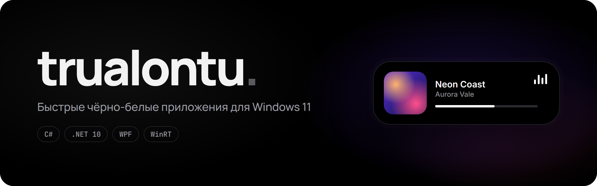
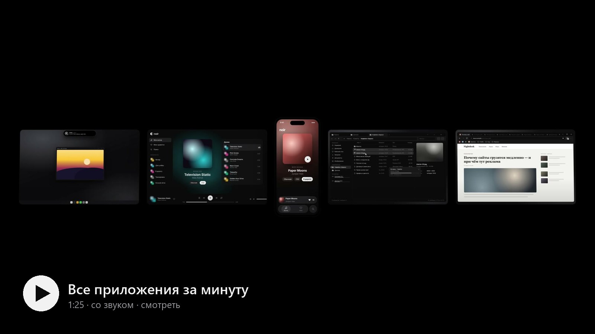
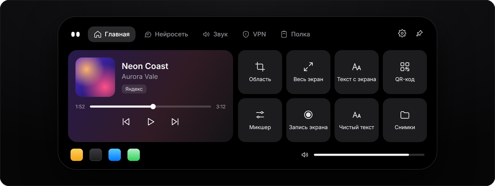
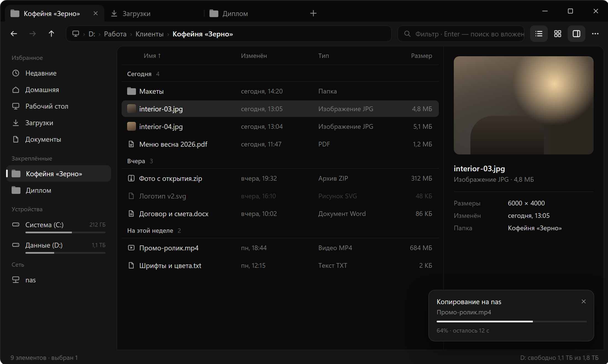
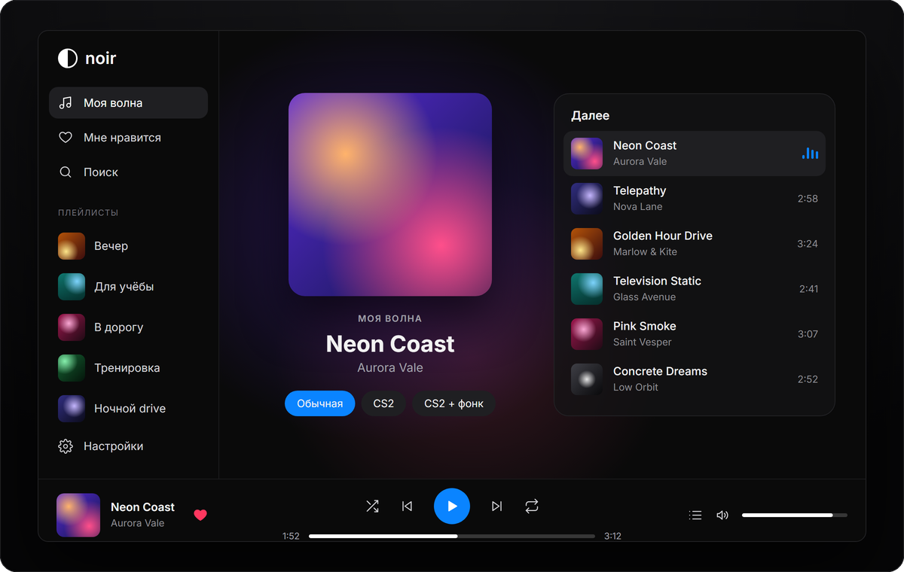
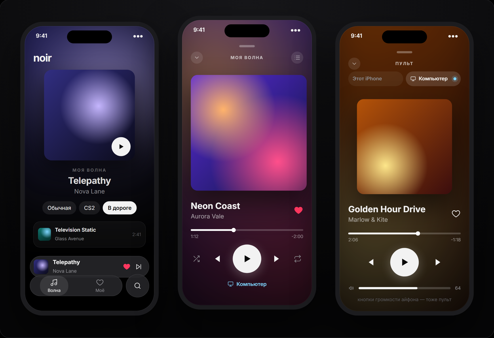
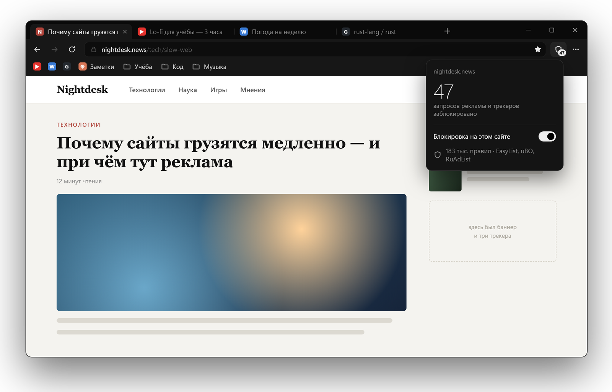

Делаю лёгкие приложения для Windows 11 и iPhone — такие, какими пользуюсь сам каждый день. 
Без лишнего: ч/б интерфейс, 0% процессора в простое, всё на событиях системы.

## Проекты

<table>
<tr>
<td width="50%" valign="top">

<h3><a href="https://github.com/trualontuu/island">Island</a></h3>
Dynamic Island для Windows 11: музыка с текстом песен, уведомления, скриншоты и запись экрана, микшер, нейросеть — в капсуле сверху экрана.
  <a href="https://github.com/trualontuu/island-releases/releases/latest/download/Island.zip"><b>↓ Скачать для Windows</b></a> · <a href="https://github.com/trualontuu/island#установка">как установить</a>
</td>
<td width="50%" valign="top">

<h3><a href="https://github.com/trualontuu/files">Files</a></h3>
Чёрно-белый файловый менеджер на Rust, быстрее Проводника: вкладки, предпросмотр, ZIP как папка, Ctrl+Z и свой прогресс копирования с отменой.
  <a href="https://github.com/trualontuu/files/releases/latest/download/Files.zip"><b>↓ Скачать для Windows</b></a> · <a href="https://github.com/trualontuu/files#установка">как установить</a>
</td>
</tr>
<tr>
<td width="50%" valign="top">

<h3><a href="https://github.com/trualontuu/player">Noir</a></h3>
Чёрно-белый плеер Яндекс Музыки и SoundCloud: «Моя волна» с режимом CS2, ровная громкость по LUFS, ~59 МБ памяти.
  <a href="https://github.com/trualontuu/player/releases/latest/download/Noir.zip"><b>↓ Скачать для Windows</b></a> · <a href="https://github.com/trualontuu/player#установка">как установить</a>
</td>
<td width="50%" valign="top">

<h3><a href="https://github.com/trualontuu/noir-ios">Noir для iPhone</a></h3>
Тот же Noir в кармане: волна, загрузки без сети, фон и экран блокировки. И пульт для Noir на компьютере, как Spotify Connect.
  <a href="https://github.com/trualontuu/noir-ios#установка"><b>↓ Установить на iPhone</b></a> · без App Store, бесплатно
</td>
</tr>
<tr>
<td width="50%" valign="top">

<h3><a href="https://github.com/trualontuu/mono">Mono</a></h3>
Чёрно-белый браузер на Rust: свой блокировщик рекламы на 180 тысяч правил, ленивые вкладки, пароли через DPAPI и переезд из Chrome в один клик.
  <a href="https://github.com/trualontuu/mono/releases/latest/download/Mono.zip"><b>↓ Скачать для Windows</b></a> · <a href="https://github.com/trualontuu/mono#установка">как установить</a>
</td>
<td width="50%" valign="top"></td>
</tr>
</table>

## Стек

